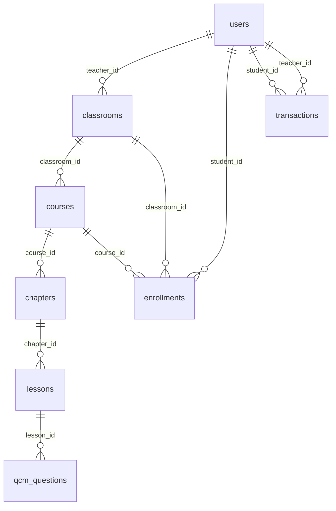

# 🎯 PLAN D'ACTION IMMÉDIAT

**Date**: 28 janvier 2026
**Priorité**: 🔴 CRITIQUE
**Temps estimé**: 2 jours

---

## ✅ CHECKLIST (Cocher au fur et à mesure)

### 🔴 JOUR 1: Corrections Critiques

#### [ ] 1.1 Désactiver ancien formulaire (15 min)

**Fichier**: `src/app/(dashboard)/teacher/classrooms/new/page.tsx`

**Option A - Redirection** (Recommandé):
```typescript
// Remplacer tout le contenu par:
import { redirect } from 'next/navigation'

export default function OldClassroomNew() {
  redirect('/teacher/classes/create')
}
```

**Option B - Suppression** (Si vous êtes sûr):
```bash
rm src/app/(dashboard)/teacher/classrooms/new/page.tsx
```

**Vérification**:
- [ ] Accéder à `/teacher/classrooms/new` → Redirige vers `/teacher/classes/create`
- [ ] Aucune erreur dans la console

---

#### [ ] 1.2 Vérifier RLS Policies appliquées (30 min)

**Fichier SQL**: `FIX-RLS-POLICIES-FINAL.sql`

**Étape 1: Vérifier si appliqué**
```sql
-- Dans Supabase SQL Editor:
SELECT policyname, cmd, qual
FROM pg_policies
WHERE tablename = 'courses'
  AND policyname = 'Anyone can view public classroom courses';
```

**Résultat attendu**: 1 ligne retournée

**Si 0 ligne**: Exécuter `FIX-RLS-POLICIES-FINAL.sql`

**Étape 2: Tester en tant que student**
1. Ouvrir fenêtre incognito
2. Se connecter comme étudiant (NON inscrit)
3. Aller sur `/search` ou `/classroom/[id]`
4. **Vérifier**: Les prix s'affichent? ✅

**Si prix ne s'affiche pas**: Problème RLS persistant

---

#### [ ] 1.3 Audit enrollments (30 min)

**Objectif**: Trouver les enrollments avec `course_id = NULL`

```sql
-- Dans Supabase SQL Editor:

-- 1. Compter les enrollments problématiques
SELECT COUNT(*) as enrollments_sans_course_id
FROM enrollments
WHERE course_id IS NULL;

-- 2. Voir les détails
SELECT
  e.id,
  e.classroom_id,
  e.course_id,
  e.student_id,
  e.enrolled_at,
  cl.title as classroom_title
FROM enrollments e
LEFT JOIN classrooms cl ON cl.id = e.classroom_id
WHERE e.course_id IS NULL
ORDER BY e.enrolled_at DESC
LIMIT 20;

-- 3. Trouver le course_id correspondant
SELECT
  e.id as enrollment_id,
  c.id as course_id,
  c.title as course_title
FROM enrollments e
JOIN courses c ON c.classroom_id = e.classroom_id
WHERE e.course_id IS NULL
LIMIT 20;
```

**Si > 0 enrollments sans course_id**: Passer à 1.4

**Si 0**: ✅ Parfait, passer à 1.5

---

#### [ ] 1.4 Migrer enrollments (30 min)

**⚠️ ATTENTION**: Backup avant de modifier!

```sql
-- 1. BACKUP
CREATE TABLE enrollments_backup_2026_01_28 AS
SELECT * FROM enrollments;

-- 2. MIGRATION
-- Mapper chaque enrollment à son course via classroom_id
UPDATE enrollments e
SET
  course_id = (
    SELECT id
    FROM courses
    WHERE classroom_id = e.classroom_id
    ORDER BY created_at  -- Prendre le premier cours de la classe
    LIMIT 1
  ),
  updated_at = NOW()
WHERE course_id IS NULL;

-- 3. VÉRIFICATION
SELECT COUNT(*) FROM enrollments WHERE course_id IS NULL;
-- Résultat attendu: 0

-- 4. VÉRIFIER cohérence
SELECT
  COUNT(*) as total_enrollments,
  COUNT(DISTINCT student_id) as unique_students,
  COUNT(DISTINCT course_id) as unique_courses
FROM enrollments
WHERE course_id IS NOT NULL;
```

**Vérification post-migration**:
- [ ] `COUNT(*) WHERE course_id IS NULL` = 0
- [ ] Étudiants peuvent accéder à leurs cours achetés

---

#### [ ] 1.5 Tester accès student (20 min)

**Test complet du flow étudiant**:

1. **Se connecter comme étudiant** (qui a acheté un cours)

2. **Aller sur /student/my-courses**
   - [ ] Voir le cours acheté
   - [ ] Voir "X leçons" (pas "0 leçons")
   - [ ] Voir barre de progression

3. **Cliquer sur le cours**
   - [ ] Redirection vers `/learn/[classroomId]`
   - [ ] Voir les chapitres
   - [ ] Voir les leçons (dont QCM si créé)

4. **Cliquer sur une leçon**
   - [ ] Contenu s'affiche
   - [ ] Si vidéo: player fonctionne
   - [ ] Si QCM: questions s'affichent

**Si erreur "0 chapitres, 0 leçons"**:
- Vérifier que l'enrollment a bien `course_id` (étape 1.3-1.4)
- Exécuter `verify-student-enrollment.sql` pour diagnostiquer

---

### 🔴 JOUR 2: Nettoyage & Documentation

#### [ ] 2.1 Merger migrations 007 (1h)

**Problème**: 3 fichiers avec même numéro

```bash
migrations/
├─ 007-complete-profile.sql
├─ 007-complete-profile-fixed.sql
└─ 007-complete-profile-all-users.sql
```

**Étape 1: Identifier quelle version est appliquée**
```sql
-- Dans Supabase SQL Editor:
-- Option A: Table de migrations
SELECT * FROM schema_migrations WHERE version LIKE '007%';

-- Option B: Vérifier colonnes ajoutées
SELECT column_name
FROM information_schema.columns
WHERE table_name = 'teacher_profiles';
-- Chercher: subjects, levels, hourly_rate, etc.
```

**Étape 2: Créer version finale**
1. Comparer les 3 fichiers (diff)
2. Créer `007-complete-profile-FINAL.sql` avec:
   - Tous les ALTER TABLE des 3 versions
   - Sans duplication
3. Tester sur DB de dev

**Étape 3: Nettoyer**
```bash
# Archiver les anciens
mkdir migrations/archive
mv migrations/007-complete-profile.sql migrations/archive/
mv migrations/007-complete-profile-fixed.sql migrations/archive/
mv migrations/007-complete-profile-all-users.sql migrations/archive/

# Garder seulement:
migrations/007-complete-profile-FINAL.sql
```

---

#### [ ] 2.2 Documenter architecture (1h)

**Créer diagramme ER** (avec DBDiagram.io ou Mermaid):



**Sauvegarder dans**: `docs/architecture/ER-DIAGRAM.md`

---

#### [ ] 2.3 Créer tests smoke (1h)

**Tests critiques à ajouter** (avec Jest ou Vitest):

```typescript
// tests/flows/enrollment.test.ts

describe('Enrollment Flow', () => {
  it('student can view course prices without enrolling', async () => {
    const courses = await getCourses()
    expect(courses[0].price).toBeDefined()
  })

  it('enrollment creates record with course_id', async () => {
    const enrollment = await createEnrollment(studentId, courseId)
    expect(enrollment.course_id).toBe(courseId)
    expect(enrollment.classroom_id).toBeDefined()
  })

  it('student can access enrolled course chapters', async () => {
    const chapters = await getChaptersByCourseId(courseId)
    expect(chapters.length).toBeGreaterThan(0)
  })
})
```

---

#### [ ] 2.4 Vérifier queries problématiques (30 min)

**Chercher usages de `classroom_id` dans chapters**:

```bash
# Dans terminal:
cd c:\Dev\jules
grep -r "chapters.*classroom_id" src/ --include="*.ts" --include="*.tsx"
```

**Pour chaque résultat**:
- Vérifier si c'est un JOIN ou un WHERE
- Si WHERE: Corriger pour utiliser `course_id`
- Si JOIN: Vérifier cohérence

**Fichiers déjà corrigés** (ne pas toucher):
- ✅ `src/app/(dashboard)/student/my-courses/page.tsx`
- ✅ `src/app/(dashboard)/learn/[classroomId]/page.tsx`
- ✅ `src/app/(dashboard)/student/dashboard/page.tsx`

---

#### [ ] 2.5 Update README (30 min)

**Ajouter section "Architecture"** dans `README.md`:

```markdown
## 🏗️ Architecture

### Modèle de Données

**Relations principales**:
- `classrooms` → `courses` → `chapters` → `lessons`
- `enrollments` lie `students` aux `courses` (via `course_id`)

**⚠️ Important**: Les enrollments utilisent `course_id`, PAS `classroom_id`.

### Migrations

Ordre d'exécution: `000` → `001` → ... → `008`

Voir [migrations/README.md](migrations/README.md) pour détails.

### Problèmes Connus

Voir [AUDIT-COMPLET-2026-01-28.md](AUDIT-COMPLET-2026-01-28.md) pour la liste complète.
```

---

## 📊 SUIVI DE PROGRESSION

| Tâche | Status | Temps | Notes |
|-------|--------|-------|-------|
| 1.1 Désactiver ancien formulaire | ⏳ | 15 min | |
| 1.2 Vérifier RLS | ⏳ | 30 min | |
| 1.3 Audit enrollments | ⏳ | 30 min | |
| 1.4 Migrer enrollments | ⏳ | 30 min | Si nécessaire |
| 1.5 Test accès student | ⏳ | 20 min | |
| 2.1 Merger migrations 007 | ⏳ | 1h | |
| 2.2 Documenter architecture | ⏳ | 1h | |
| 2.3 Tests smoke | ⏳ | 1h | |
| 2.4 Vérifier queries | ⏳ | 30 min | |
| 2.5 Update README | ⏳ | 30 min | |

**Total estimé**: ~6h sur 2 jours

---

## 🚨 EN CAS DE PROBLÈME

### Problème: Student ne voit toujours pas ses cours

**Diagnostic**:
```sql
-- 1. Vérifier enrollment
SELECT e.*, c.title
FROM enrollments e
LEFT JOIN courses c ON c.id = e.course_id
WHERE e.student_id = 'STUDENT_USER_ID';

-- 2. Vérifier chapters
SELECT ch.id, ch.title, ch.course_id
FROM chapters ch
WHERE ch.course_id = (
  SELECT course_id FROM enrollments
  WHERE student_id = 'STUDENT_USER_ID'
  LIMIT 1
);

-- Si 0 chapters: Le cours n'a pas de contenu!
-- → Teacher doit créer chapitres/leçons
```

### Problème: RLS bloque l'accès

**Diagnostic**:
```sql
-- Voir toutes les policies sur courses
SELECT schemaname, tablename, policyname, cmd, qual
FROM pg_policies
WHERE tablename = 'courses';

-- Vérifier que "Anyone can view public..." existe
-- Si non: Exécuter FIX-RLS-POLICIES-FINAL.sql
```

### Problème: Migration 007 échoue

**Solution**:
```sql
-- Vérifier colonnes existantes
SELECT column_name FROM information_schema.columns
WHERE table_name = 'teacher_profiles';

-- Supprimer colonnes si déjà créées
ALTER TABLE teacher_profiles DROP COLUMN IF EXISTS subjects;
-- ... pour chaque colonne

-- Réexécuter migration
```

---

## ✅ VALIDATION FINALE

Après avoir complété toutes les tâches:

- [ ] Ancien formulaire inaccessible
- [ ] RLS policies appliquées et testées
- [ ] Tous les enrollments ont `course_id`
- [ ] Students voient leurs cours achetés
- [ ] Migrations 007 mergées
- [ ] Documentation à jour
- [ ] Tests smoke passent
- [ ] Aucune query utilise `chapters.classroom_id`

**Si toutes les cases cochées**: 🎉 Corrections critiques terminées!

**Prochaine étape**: Plan d'action court terme (1 semaine) - Voir [AUDIT-COMPLET-2026-01-28.md](AUDIT-COMPLET-2026-01-28.md) Section 8.

---

**Créé**: 28 janvier 2026
**Priorité**: 🔴 CRITIQUE
**Status**: 🏃 EN COURS
