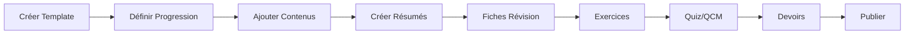

# 📚 Guide Complet - Système de Template de Cours Moderne

## Vue d'Ensemble

Le système de template de cours Jules Class Go permet aux professeurs de créer des cours **structurés, pédagogiques et modernes** avec:

✅ **Progression pédagogique** semaine par semaine
✅ **Contenus de cours** variés (vidéos, textes, PDFs, slides)
✅ **Résumés automatiques** avec points clés et concepts importants
✅ **Fiches de révision** avec mnémotechniques
✅ **Exercices corrigés** détaillés avec solutions étape par étape
✅ **QCM et Quiz** interactifs avec explications
✅ **Devoirs personnalisés** avec grilles d'évaluation

---

## 🎯 Philosophie Pédagogique

### Approche Structurée

Le template suit une **progression logique** :

```
Semaine 1: Introduction et bases
  ├── Cours (vidéo + texte)
  ├── Résumé (points clés)
  ├── Fiche révision (essentiels)
  ├── Exercices d'application
  ├── Quiz de validation
  └── Devoir optionnel

Semaine 2: Approfondissement
  └── ... (même structure)
```

### Bloom's Taxonomy

Les exercices suivent la taxonomie de Bloom:

1. **Application** (Easy) - Appliquer une règle/formule
2. **Analyse** (Medium) - Décomposer un problème
3. **Synthèse** (Hard) - Créer une solution complète

---

## 🏗️ Architecture du Système

### Tables de Base de Données

```sql
course_templates          -- Template principal
├── pedagogical_progressions    -- Progressions par semaine
    ├── lesson_contents          -- Contenus de cours
    ├── course_summaries         -- Résumés
    ├── revision_sheets          -- Fiches de révision
    ├── exercises                -- Exercices corrigés
    ├── qcm_questions            -- Questions QCM
    ├── quizzes                  -- Quiz complets
    └── homeworks                -- Devoirs
        └── homework_exercises   -- Lien exercices-devoirs
```

### Flux de Travail Professeur



---

## 📖 Utilisation - Créer un Cours

### Étape 1: Créer le Template

1. Aller sur **Teacher Dashboard**
2. Cliquer sur **"Templates de Cours"**
3. Cliquer sur **"+ Nouveau Template"**
4. Remplir:
   - **Titre**: "Mathématiques - Les Fonctions"
   - **Matière**: Mathématiques
   - **Niveau**: Terminale
   - **Durée**: 12 semaines
   - **Description**: Objectifs généraux

### Étape 2: Progression Pédagogique

Pour chaque semaine, définir:

**📋 Informations**
- Numéro de semaine
- Titre de la semaine
- Objectifs d'apprentissage
- Compétences visées
- Prérequis

**Exemple:**
```
Semaine 1: Introduction aux Fonctions

Objectifs:
- Comprendre la notion de fonction
- Savoir lire un graphique
- Déterminer l'image d'un nombre

Compétences:
- Représenter
- Calculer
- Raisonner

Prérequis:
- Coordonnées dans un repère
- Calcul littéral
```

### Étape 3: Contenu de Cours

Ajouter différents types de contenus:

#### 🎥 Vidéo
```
Titre: "Qu'est-ce qu'une fonction?"
Durée: 15 minutes
URL: [lien vidéo]
```

#### 📝 Texte/Markdown
```markdown
# Les Fonctions - Définition

Une fonction est une relation qui...

## Notation
On note f: x → f(x)

## Exemple
La fonction carré: f(x) = x²
```

#### 📄 PDF
```
Titre: "Cours complet - Les Fonctions"
Fichier: fonctions.pdf
```

### Étape 4: Résumé de Cours

**Points Clés** (bullet points):
- Une fonction associe à chaque nombre x un unique nombre f(x)
- Le graphique représente l'ensemble des points (x, f(x))
- L'image de x par f est f(x)

**Concepts Importants** (avec définitions):
```json
{
  "concept": "Fonction",
  "definition": "Relation qui associe à chaque nombre un unique résultat",
  "example": "f(x) = 2x + 3 associe 5 à 13"
}
```

**Formules** (si applicable):
```json
{
  "name": "Fonction linéaire",
  "formula": "f(x) = ax",
  "description": "Où a est le coefficient directeur"
}
```

### Étape 5: Fiche de Révision

**Concepts Essentiels**:
- Définition de fonction
- Notation f: x → f(x)
- Image et antécédent
- Représentation graphique

**Mnémotechniques**:
```
"Image" → "Ce qu'on imagine" → f(x)
"Antécédent" → "Ce qui vient avant" → x
```

**Récapitulatif Rapide**:
- Pour trouver f(3), remplacer x par 3
- Sur le graphique, lire l'ordonnée

**Erreurs Courantes**:
- Confondre image et antécédent
- Oublier les parenthèses: f(2) ≠ f2

### Étape 6: Exercices Corrigés

**Exercice d'Application** (Facile):
```
Type: Application
Difficulté: Facile
Points: 5

Question:
Soit f(x) = 2x + 1.
Calculer f(3).

Indices:
- Remplacer x par 3
- Suivre l'ordre des opérations

Solution:
Étape 1: f(3) = 2(3) + 1
Étape 2: f(3) = 6 + 1
Étape 3: f(3) = 7

Réponse: 7

Explication:
On remplace la variable x par 3 dans l'expression,
puis on calcule: d'abord la multiplication, puis l'addition.
```

**Exercice d'Analyse** (Moyen):
```
Type: Analyse
Difficulté: Moyen
Points: 10

Question:
Sur le graphique, déterminer:
a) f(2)
b) Le(s) antécédent(s) de 3

Indices:
- Pour l'image, lire l'ordonnée
- Pour l'antécédent, lire l'abscisse

Solution: [détaillée]
```

**Exercice de Synthèse** (Difficile):
```
Type: Synthesis
Difficulté: Hard
Points: 15

Question:
Déterminer l'expression d'une fonction affine
qui passe par les points A(1, 3) et B(4, 9).

Solution: [étapes complètes]
```

### Étape 7: Quiz et QCM

**Question QCM**:
```json
{
  "question": "Quelle est l'image de 2 par f(x) = 3x - 1 ?",
  "options": [
    { "id": "a", "text": "5", "is_correct": true },
    { "id": "b", "text": "6", "is_correct": false },
    { "id": "c", "text": "7", "is_correct": false },
    { "id": "d", "text": "4", "is_correct": false }
  ],
  "explanation": "f(2) = 3(2) - 1 = 6 - 1 = 5",
  "difficulty": "easy",
  "points": 1
}
```

**Quiz Complet**:
```
Titre: "Quiz - Semaine 1"
Description: "Validez vos connaissances"
Temps limite: 15 minutes
Note de passage: 60%

Questions: [10 QCM]
```

### Étape 8: Devoirs

**Structure du Devoir**:
```
Titre: "Devoir Maison #1 - Les Fonctions"
Description: "Appliquer les notions vues en cours"

Instructions:
- Répondre sur feuille
- Détailler les calculs
- À rendre sous 7 jours

Points maximum: 20
Note de passage: 60%

Exercices:
- Exercice 1 (5 pts): Application simple
- Exercice 2 (7 pts): Problème
- Exercice 3 (8 pts): Synthèse

Grille d'Évaluation:
- Compréhension (5 pts)
- Rigueur calcul (7 pts)
- Raisonnement (8 pts)
```

---

## 🎨 Design et UX

### Codes Couleur

```css
/* Cours */
.lesson-video { background: #dbeafe; color: #2b8cee; }
.lesson-text { background: #f3e8ff; color: #8b5cf6; }
.lesson-pdf { background: #fef3c7; color: #d97706; }

/* Exercices par difficulté */
.difficulty-easy { background: #d1fae5; color: #16a34a; }
.difficulty-medium { background: #fef3c7; color: #d97706; }
.difficulty-hard { background: #fee2e2; color: #dc2626; }

/* Statut */
.status-completed { background: #d1fae5; }
.status-in-progress { background: #dbeafe; }
.status-not-started { background: #f3f4f6; }
```

### Icônes

```
📚 Cours principal
📖 Chapitre
📝 Leçon texte
🎥 Vidéo
📄 PDF
📊 Slide
📋 Résumé
🎯 Objectifs
✅ Quiz/QCM
📝 Exercice
📚 Devoir
⭐ Révision
💡 Astuce
⚠️ Erreur commune
```

---

## 🔧 Configuration Technique

### 1. Créer les Tables

```bash
# Exécuter dans Supabase SQL Editor
cat supabase-course-template-setup.sql | pbcopy
# Puis coller dans SQL Editor
```

### 2. Vérifier les Buckets

Les templates peuvent nécessiter des buckets pour:
- Vidéos de cours
- PDFs
- Slides/présentations

```bash
npx tsx scripts/verify-buckets.ts
```

### 3. Tester la Création

1. Aller sur `/teacher/course-templates/new`
2. Créer un template de test
3. Vérifier dans Supabase que la ligne est créée

---

## 📊 Métriques et Suivi

### Pour les Professeurs

**Dashboard Template:**
- Nombre total de templates
- Templates publiés vs brouillons
- Progressions complètes vs incomplètes
- Exercices par template
- Quiz créés

**Statistiques d'Usage:**
- Étudiants inscrits
- Taux de complétion
- Note moyenne aux quiz
- Devoirs rendus

### Pour les Étudiants

**Progression:**
- Semaines complétées
- Quiz réussis
- Exercices terminés
- Devoirs rendus
- Note globale

---

## 🚀 Prochaines Étapes

### Phase 1: Core Features (Actuel)
- ✅ Structure de base
- ✅ Types de données
- ✅ Interface création
- ⏳ Éditeur de progression
- ⏳ Générateur de contenu

### Phase 2: Enrichissement
- 📝 Éditeur Markdown enrichi
- 🎨 Templates visuels prédéfinis
- 🤖 Suggestions IA pour contenus
- 📊 Analytics avancées
- 🔄 Import/Export de templates

### Phase 3: Collaboration
- 👥 Partage entre professeurs
- 💬 Commentaires et feedback
- 🌟 Marketplace de templates
- 🏆 Templates recommandés

---

## ❓ FAQ

### Q: Combien de temps pour créer un cours complet?
**R:** Environ 2-3 heures pour un cours de 12 semaines avec la structure complète.

### Q: Peut-on réutiliser des exercices?
**R:** Oui! Les exercices sont stockés dans une bibliothèque réutilisable.

### Q: Les étudiants voient-ils les corrections?
**R:** Oui, après avoir soumis leur réponse ou après la date limite.

### Q: Peut-on modifier un template publié?
**R:** Oui, les modifications sont versionnées. Les étudiants déjà inscrits gardent l'ancienne version.

### Q: Comment exporter un template?
**R:** JSON export disponible pour partage avec d'autres professeurs.

---

## 📞 Support

Pour toute question sur le système de templates:
1. Consulter ce guide
2. Vérifier les exemples dans `/examples/course-templates/`
3. Contacter le support technique

**Bon enseignement ! 🎓**
